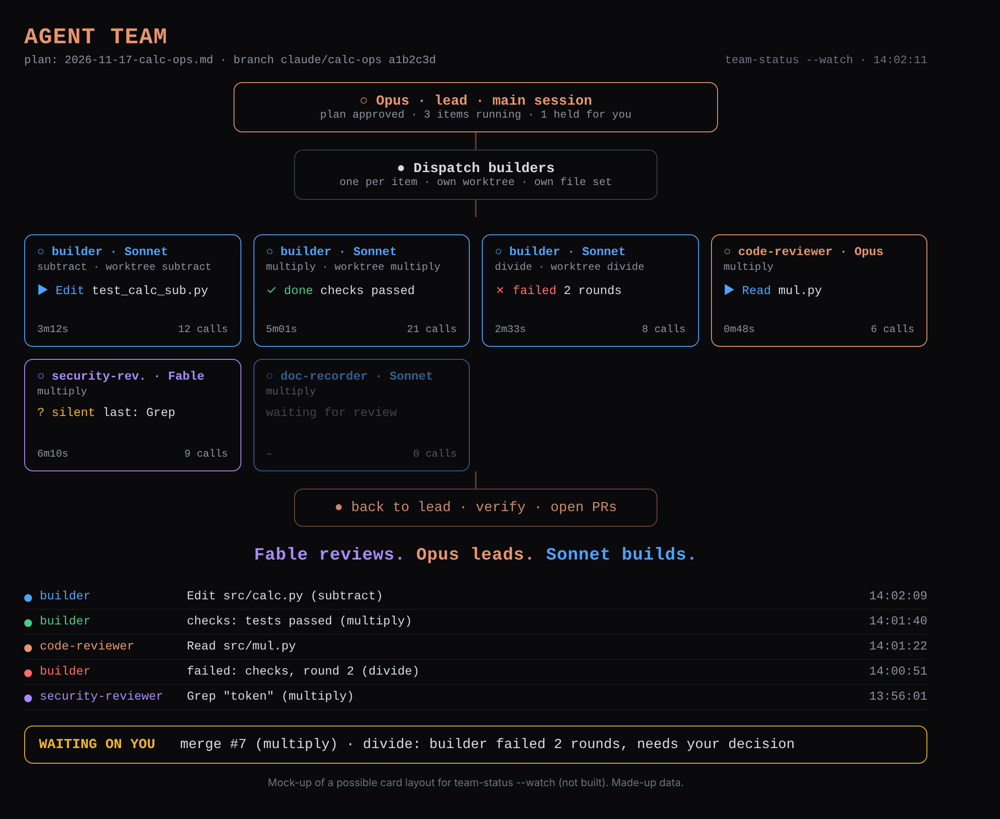

**English** · [简体中文](README.zh-CN.md) · [မြန်မာ](README.my.md)

# agent-team

A Claude Code plugin: an AI agent team with a model per role, one workflow from plan to pull request, steps only the owner may take, and a `team-status` command for the terminal.



*Mock-up of the live view (the `--watch` mode of team-status) with made-up data, not a screenshot of a real run.*

The design is `docs/specs/2026-11-17-agent-team-plugin-design.md`.

## Install (once per machine)

In Claude Code:

```
/plugin marketplace add DavidWin105/agent-team
/plugin install agent-team@agent-team-local
```

## Use in a project

1. `/team-init` writes `.claude/team.json`.
2. Ask the lead to plan a task; approve the plan; ask it to run the plan.
3. `/team-status`, or from a clone of this repository in any terminal: `python3 -I agent-team/scripts/team-status <project-dir>`.

### Watch it live

1. In Claude Code, run `/team-watch`. It prints one line with the real plugin folder and your project folder filled in.
2. Open a second terminal and paste that line. It looks like this, and refreshes every second until Ctrl+C:

```bash
python3 -I <plugin folder>/scripts/team-status --watch <project folder>
```

From a clone of this repository, in any terminal: `python3 -I agent-team/scripts/team-status --watch <project-dir>`. On a terminal 100 columns wide or more it draws cards; on a narrower one it draws a table. `/team-status` (without watching) prints a single snapshot.

### What the live view shows and does not

It shows each team agent's role, item, state, what it is doing and its tool calls, recorded by hooks. It records only tool names, file paths relative to the project (or to a builder's worktree) and the first word of a Bash command (never file contents, other command text or output; a command that starts with a `VAR=value` word is logged with no name). Hooks cannot tell that an agent failed, so a stopped agent shows as done; a failed tool call shows as, for example, `Bash (failed)`. The hook field names are documented, not yet observed in a real run.

### Checking the live view

Not yet run by the author. To check it yourself:

1. Install the plugin in a scratch git repository and run `/team-init`.
2. In a second terminal, open `python3 -I <path-to>/agent-team/scripts/team-status --watch <scratch-dir>`.
3. In the first terminal, ask the lead to plan and run a two-item plan (for example, a `subtract` and a `multiply` function in separate files).
4. Check that each agent appears, shows what it is doing, and ends as done.

## Other tools (Codex, Cursor, Gemini)

Not yet run in any of these tools. The same workflow runs inside Codex CLI, Cursor or Gemini CLI, with the whole team in one tool at a time.

1. Clone this repository.
2. Run `python3 -I agent-team/scripts/team-adapt --init <project-dir>`. It asks which tools you use and which model fills each tier (strongest, strong, standard, fast) for each, then writes `.claude/team.json` and the tool files:
   - agents in `.codex/agents/`, `.cursor/agents/` or `.gemini/agents/`, one per role and tier, named for example `builder-standard`;
   - the lead skill in `.agents/skills/agent-team/`;
   - a marked block in `AGENTS.md` or `GEMINI.md`.
3. Commit those files. After changing models, rerun `python3 -I agent-team/scripts/team-adapt <project-dir>`.

`team-adapt` overwrites or deletes only files it wrote, and writes nothing if it finds a problem. The generated `.agents/skills/agent-team/SKILL.md` names this clone by its absolute path. That path includes your user name and differs per machine, so a teammate with the clone elsewhere reruns `team-adapt`. The live agent view works only in Claude Code. If you configure both Codex and Cursor, Cursor also reads `.codex/agents/`, so check which agent it starts. Design: `docs/specs/2026-11-17-multi-tool-adapters-design.md`.

## Tests

```bash
cd tests && PYTHONPATH=../scripts python3 -m unittest discover -v
```

## License

MIT. See `LICENSE`.
