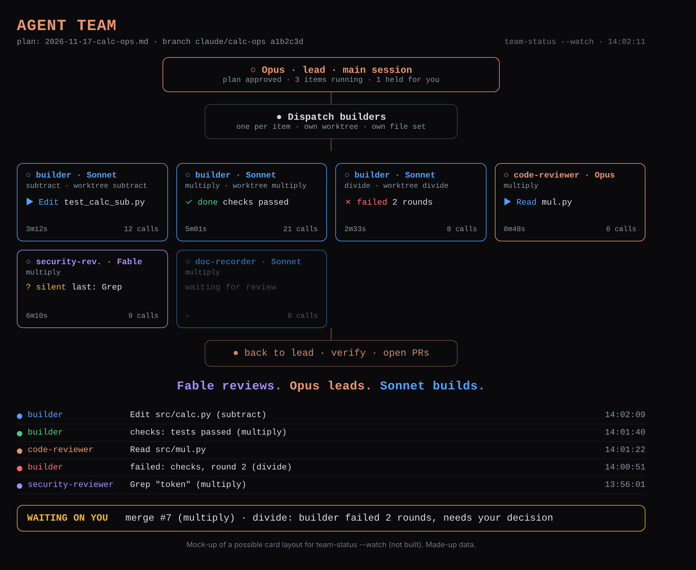

[English](README.md) · [简体中文](README.zh-CN.md) · **မြန်မာ**

# agent-team

Claude Code plugin တစ်ခုဖြစ်သည်။ အခန်းကဏ္ဍတစ်ခုစီအတွက် မော်ဒယ်တစ်ခုစီ အသုံးပြုသော AI agent အဖွဲ့၊ စီမံကိန်းမှ pull request အထိ တစ်ခုတည်းသော လုပ်ငန်းစဉ်၊ ပိုင်ရှင်သာ လုပ်ဆောင်နိုင်သော အဆင့်များနှင့် terminal အတွက် `team-status` command တို့ ပါဝင်သည်။



*Live view (team-status ၏ `--watch` mode) ၏ နမူနာပုံဖြစ်ပြီး ဒေတာများသည် စိတ်ကူးယဉ်ဖြစ်သည်။ တကယ်လည်ပတ်ထားသော screenshot မဟုတ်ပါ။*

ဒီဇိုင်းစာတမ်းမှာ `docs/specs/2026-11-17-agent-team-plugin-design.md` ဖြစ်သည်။

## ထည့်သွင်းခြင်း (စက်တစ်လုံးလျှင် တစ်ကြိမ်)

Claude Code ထဲတွင်:

```
/plugin marketplace add DavidWin105/agent-team
/plugin install agent-team@agent-team-local
```

## Project တစ်ခုတွင် အသုံးပြုခြင်း

1. `/team-init` က `.claude/team.json` ကို ရေးပေးသည်။
2. lead (ခေါင်းဆောင် agent) ကို အလုပ်တစ်ခုအတွက် စီမံကိန်းရေးခိုင်းပါ၊ စီမံကိန်းကို ခွင့်ပြုပါ၊ ထို့နောက် စီမံကိန်းအတိုင်း လုပ်ဆောင်ခိုင်းပါ။
3. `/team-status` ကို သုံးပါ၊ သို့မဟုတ် ဤ repository ၏ clone ရှိလျှင် မည်သည့် terminal တွင်မဆို `python3 -I agent-team/scripts/team-status <project-dir>` ကို run ပါ။

### တိုက်ရိုက် ကြည့်ရှုခြင်း

1. Claude Code ထဲတွင် `/team-watch` ကို run ပါ။ plugin folder နှင့် သင့် project folder အစစ်အမှန်များ ထည့်ပြီးသား command တစ်ကြောင်းကို ထုတ်ပေးသည်။
2. ဒုတိယ terminal တစ်ခု ဖွင့်ပြီး ထိုစာကြောင်းကို paste လုပ်ပါ။ အောက်ပါအတိုင်း ဖြစ်ပြီး Ctrl+C နှိပ်သည်အထိ တစ်စက္ကန့်လျှင် တစ်ကြိမ် refresh လုပ်သည်။

```bash
python3 -I <plugin folder>/scripts/team-status --watch <project folder>
```

ဤ repository ၏ clone ရှိလျှင် မည်သည့် terminal တွင်မဆို: `python3 -I agent-team/scripts/team-status --watch <project-dir>`။ terminal က ကော်လံ ၁၀၀ နှင့်အထက် ကျယ်လျှင် card များကို ပြပြီး ပိုကျဉ်းလျှင် ဇယားကို ပြသည်။ `/team-status` (မကြည့်ဘဲ) သည် snapshot တစ်ကြိမ်သာ ထုတ်ပေးသည်။

### Live view က ဘာတွေ ပြသည်၊ ဘာတွေ မပြသည်

team agent တစ်ခုစီ၏ အခန်းကဏ္ဍ၊ အလုပ်ပိုင်း၊ အခြေအနေ၊ လက်ရှိ လုပ်နေသည့်အရာနှင့် tool ခေါ်ဆိုမှု အရေအတွက်ကို ပြသည်။ ၎င်းတို့ကို hooks များက မှတ်တမ်းတင်သည်။ tool အမည်များ၊ project နှင့် နှိုင်းယှဉ်သော (သို့မဟုတ် builder ၏ worktree နှင့် နှိုင်းယှဉ်သော) ဖိုင်လမ်းကြောင်းများနှင့် Bash command ၏ ပထမစကားလုံးကိုသာ မှတ်တမ်းတင်သည် (ဖိုင်အကြောင်းအရာ၊ command ၏ ကျန်အပိုင်း သို့မဟုတ် output ကို လုံးဝ မမှတ်ပါ။ `VAR=value` ဖြင့် စသော command ကို အမည်မပါဘဲ မှတ်တမ်းတင်သည်)။ hooks များက agent တစ်ခု မအောင်မြင်ကြောင်း မသိနိုင်သဖြင့် ရပ်သွားသော agent ကို ပြီးစီးသည်ဟု ပြသည်။ မအောင်မြင်သော tool ခေါ်ဆိုမှုကို `Bash (failed)` ကဲ့သို့ ပြသည်။ hook field အမည်များသည် စာတမ်းအရ ဖြစ်ပြီး တကယ် run ကြည့်၍ မအတည်ပြုရသေးပါ။

### Live view ကို စစ်ဆေးခြင်း

ရေးသားသူက မ run ကြည့်ရသေးပါ။ သင်ကိုယ်တိုင် စစ်ဆေးရန်:

1. စမ်းသပ်ရန် git repository တစ်ခုတွင် plugin ကို ထည့်သွင်းပြီး `/team-init` ကို run ပါ။
2. ဒုတိယ terminal တွင် `python3 -I <path-to>/agent-team/scripts/team-status --watch <scratch-dir>` ကို run ပါ။
3. ပထမ terminal တွင် lead ကို အလုပ်နှစ်ခုပါသော စီမံကိန်းတစ်ခု ရေးပြီး လုပ်ဆောင်ခိုင်းပါ (ဥပမာ ဖိုင်အသီးသီးတွင် `subtract` နှင့် `multiply` function များ)။
4. agent တစ်ခုစီ ပေါ်လာခြင်း၊ လုပ်နေသည့်အရာကို ပြခြင်းနှင့် နောက်ဆုံး ပြီးစီးခြင်းအဖြစ် ပြောင်းခြင်းတို့ကို စစ်ဆေးပါ။

## စမ်းသပ်မှုများ

```bash
cd tests && PYTHONPATH=../scripts python3 -m unittest discover -v
```

## လိုင်စင်

MIT။ `LICENSE` ကို ကြည့်ပါ။
