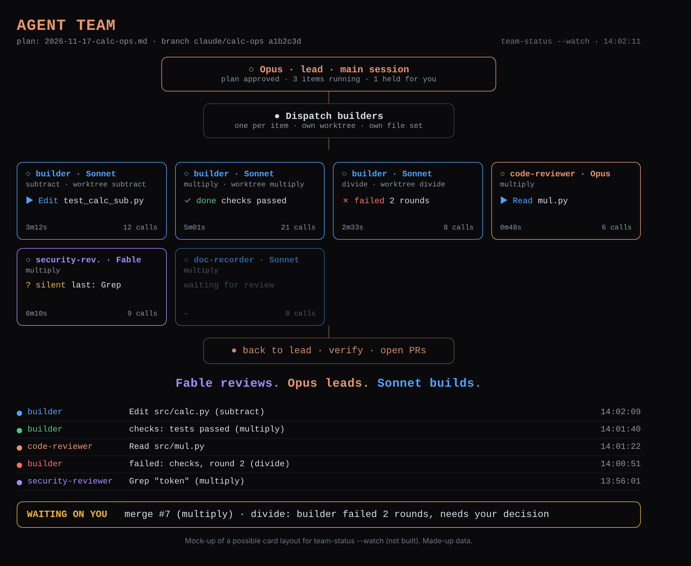

[English](README.md) · **简体中文** · [မြန်မာ](README.my.md)

# agent-team

这是一个 Claude Code 插件：由 AI 智能体组成的团队，每个角色使用各自的模型；从制定计划到提交拉取请求（PR）遵循同一套流程；合并、部署等关键步骤只能由负责人（owner）本人执行；并提供用于终端的 `team-status` 命令。



*实时视图（team-status 的 `--watch` 模式）示意图，数据为虚构，并非真实运行的截图。*

设计文档见 `docs/specs/2026-11-17-agent-team-plugin-design.md`。

## 安装（每台机器一次）

在 Claude Code 中：

```
/plugin marketplace add DavidWin105/agent-team
/plugin install agent-team@agent-team-local
```

## 在项目中使用

1. `/team-init` 会写入 `.claude/team.json`。
2. 让 lead（主导智能体）为任务制定计划；你批准计划后，再让它按计划执行。
3. 运行 `/team-status`；也可以在本仓库的克隆目录下，于任意终端中运行：`python3 -I agent-team/scripts/team-status <project-dir>`。

### 实时查看

1. 在 Claude Code 中运行 `/team-watch`。它会输出一行命令，其中已填好真实的插件目录和你的项目目录。
2. 打开第二个终端，把这一行粘贴进去。命令形如下面这样，它每秒刷新一次，直到你按 Ctrl+C 为止：

```bash
python3 -I <plugin folder>/scripts/team-status --watch <project folder>
```

如果你本地有本仓库的克隆，可以在任意终端中直接运行：`python3 -I agent-team/scripts/team-status --watch <project-dir>`。终端宽度不小于 100 列时显示卡片，更窄时显示表格。单独运行 `/team-status`（不带 `--watch`）只会输出一次快照。

### 实时视图显示什么、不显示什么

它会显示每个团队智能体的角色、所负责的任务项、当前状态、正在做什么，以及工具调用次数；这些数据由钩子（hooks）记录。日志里只保留工具名称、相对于项目（或相对于 builder 工作树）的文件路径，以及 Bash 命令的第一个词，绝不记录文件内容、命令的其余部分或命令输出；以 `VAR=value` 开头的命令不会记录命令名。钩子无法判断智能体是否失败，所以已停止的智能体一律显示为完成；失败的工具调用会显示成类似 `Bash (failed)` 的样子。钩子的字段名取自文档，尚未在真实运行中验证过。

### 检查实时视图

作者还没有在真实环境中运行过。你可以按下面的步骤自己检查：

1. 在一个临时的 git 仓库中安装插件，并运行 `/team-init`。
2. 在第二个终端中运行 `python3 -I <path-to>/agent-team/scripts/team-status --watch <scratch-dir>`。
3. 在第一个终端中，让 lead 制定并执行一个包含两项任务的计划（例如，在不同文件中分别实现 `subtract` 和 `multiply` 函数）。
4. 确认每个智能体都会出现，显示它正在做什么，并最终变为完成状态。

## 测试

```bash
cd tests && PYTHONPATH=../scripts python3 -m unittest discover -v
```

## 许可证

MIT。详见 `LICENSE`。
